# الدورة الكاملة لطلب خاص: مطعم زوارق الشاطئ — كارتون 40

> صور هذا الدليل في `images/fullcycle/` تُلتقط من الشاشات الفعلية على Windows (اختبار `Illustrated_guide_full_cycle_special_order`)،
> والمسار نفسه يُفحص بلا رسم في كل تشغيل للاختبارات (`FullCycleJourneyTests`).

## المثال
- **المنتج:** «ماء الرحمة 330 مل كارتون 40» — كارتون فيه 40 قنينة، ولكل قنينة **ليبلان** (80 ليبل للكارتون).
- **الطلب:** 10 كراتين عامة + 5 كراتين لـ«مطعم زوارق الشاطئ» بليبله الخاص، في **أمر إنتاج واحد**.
- **التوزيع:** 6 كراتين عامة + كراتين المطعم الخمس تُحمَّل على سيارة المندوب «كاش فان علي».

## التنقل في البرنامج
كل وحدة في القائمة الجانبية تفتح تحتها **«الرئيسية»** ثم **مجموعات ملوّنة** (مثل المخازن: مساحات المخازن، الحركة اليومية، الأرصدة والتنبيهات، التصنيع، التعريفات).
اضغط المجموعة لتظهر أقسامها، والقسم المفتوح مظلّل بلون مجموعته، ومساره يظهر تحت اسم الوحدة (مثل «التعريفات ‹ الأصناف»).
المستخدم الذي عمله في وحدة واحدة (مثل أمين المخزن أو مسؤول الموارد البشرية) يفتح على وحدته مباشرة.

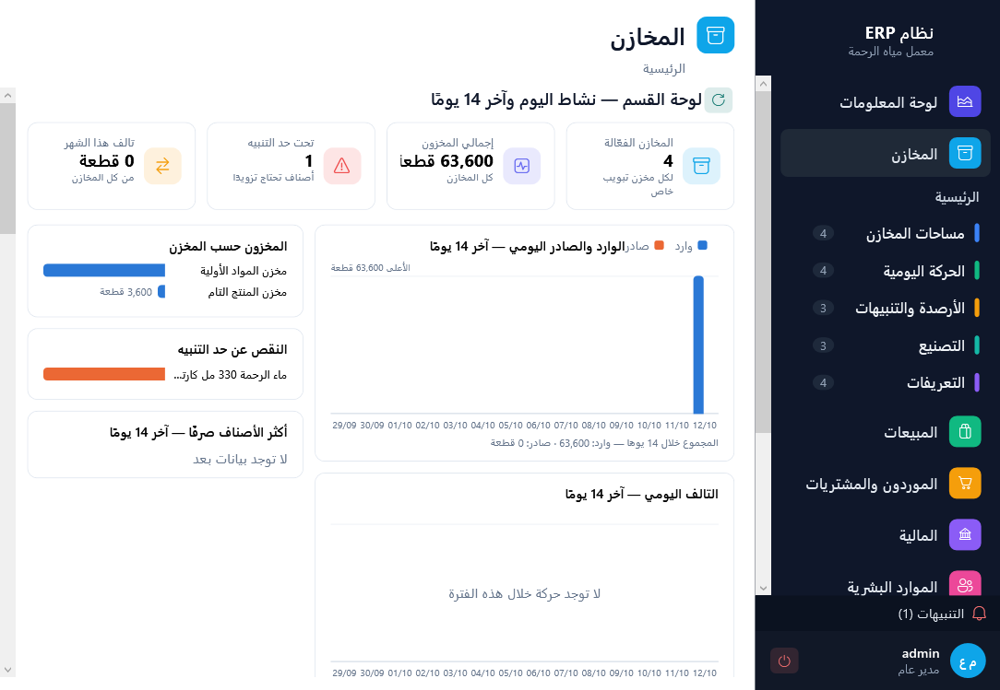

## 1) الليبل الخاص: تعريفه واستلامه (المخازن)
1. **المخازن ← التعريفات ← الأصناف ← جديد:** الرمز `RM-LBL-ZWQ`، الاسم «ليبل مطعم زوارق الشاطئ»، طريقة التوريد **شراء**. احفظ.

   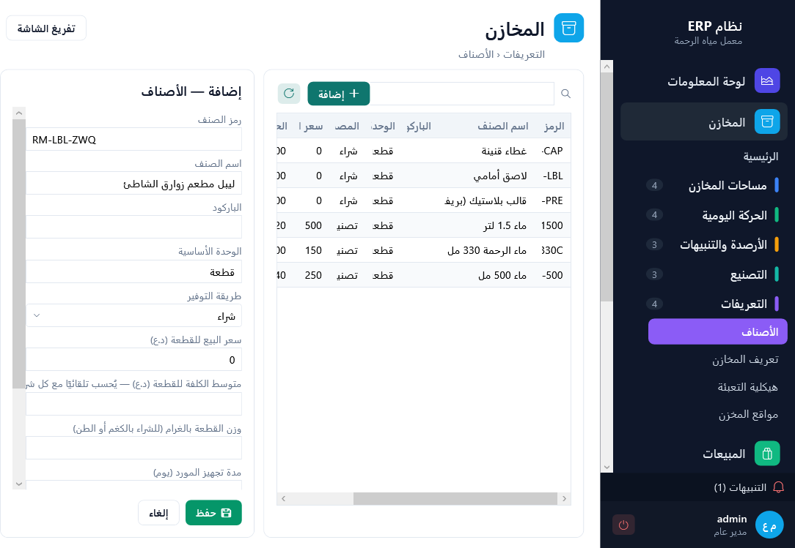
2. **المخازن ← مساحات المخازن ← مخزن المواد الأولية ← عملية جديدة:** النوع «استلام»، الجهة «مطبعة الفيحاء — فاتورة 1530»، الصنف الليبل الخاص، الكمية 1000، رقم الدفعة والصلاحية ← «إضافة السطر» ← حفظ.

   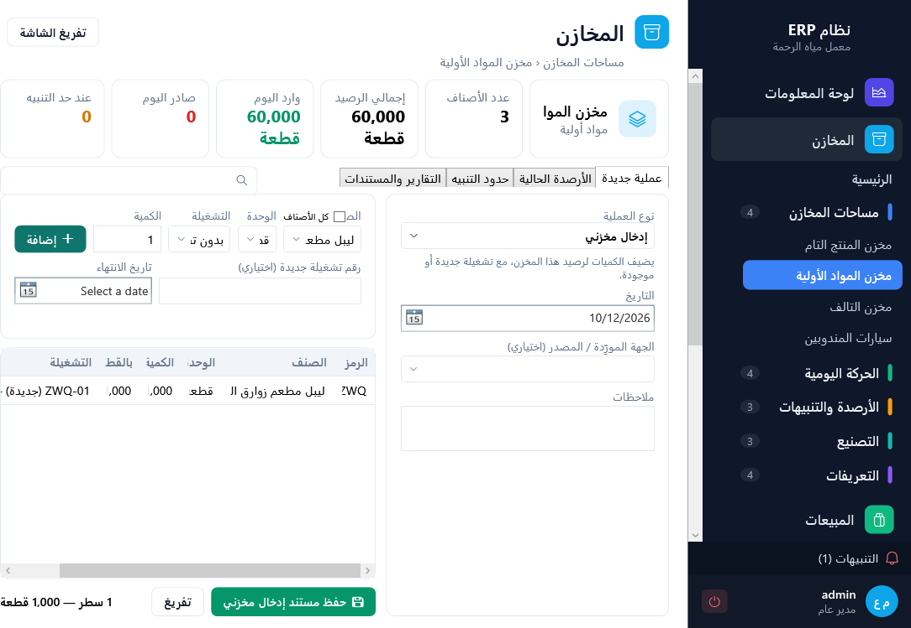

## 2) وصفة المطعم (الإنتاج ← الإعداد ← الوصفات المخصصة)
1. **جديد:** الاسم «مطعم زوارق الشاطئ»، المنتج «ماء الرحمة 330 مل كارتون 40»، العميل «مطعم زوارق الشاطئ». احفظ.

   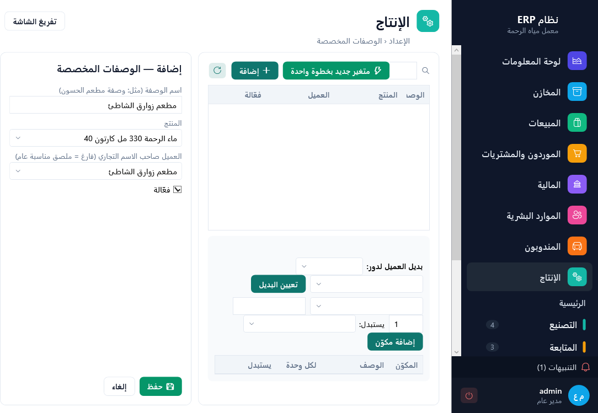
2. اختر الوصفة، ثم المكوّن «ليبل مطعم زوارق الشاطئ»، الدور «لاصق»، **الكمية 2** (ليبلان للقنينة)، **يحل محل** «لاصق أمامي» ← «إضافة».

   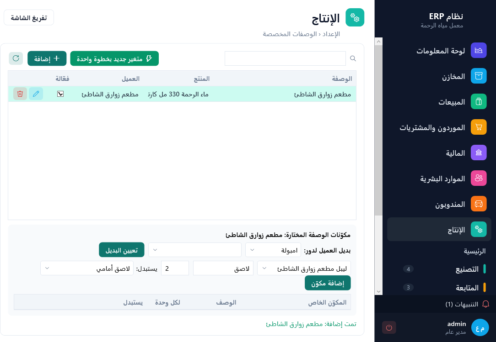
   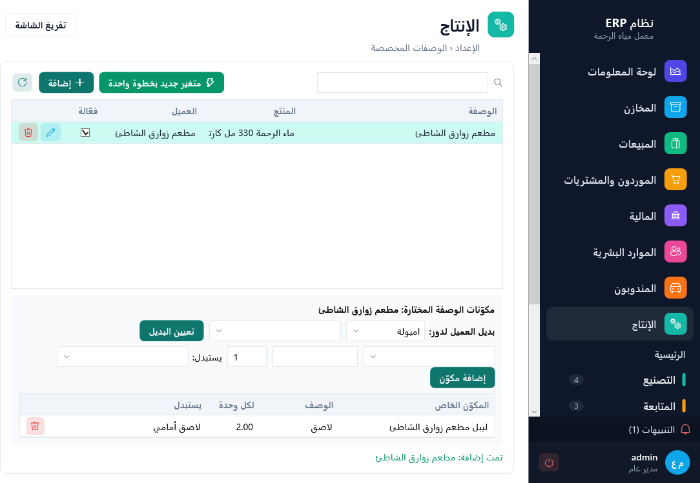

> الكمية لكل قنينة: 2 لأن على القنينة ليبلين. فالكارتون (40) يصرف 80 ليبل، والشرنك (20) يصرف 40.

## 3) أمر إنتاج واحد بسطرين — بالكارتون (الإنتاج ← التصنيع ← أوامر الإنتاج)
1. **أمر جديد:** الماكينة «نافخة 1»، المنتج «ماء الرحمة 330 مل كارتون 40». الوحدة **كارتون** (تظهر تلقائيًا)، العدد **10**، وتحته المعادلة «10 كارتون = 400 قطعة» ← **«إضافة الصنف للأمر»**.

   
2. المنتج نفسه مرة ثانية، الوصفة «مطعم زوارق الشاطئ»، العدد **5** ← **«معاينة المواد المطلوبة»**: الليبل الخاص 400 (5 × 40 × 2)، والليبل العام 800 للكراتين العامة فقط.

   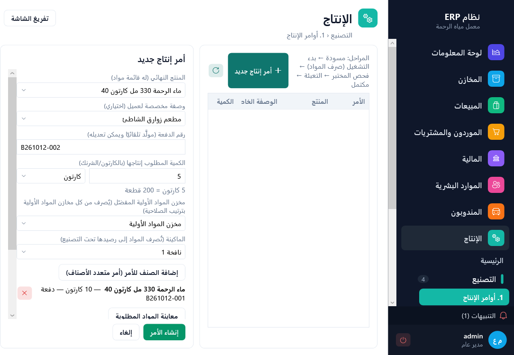
3. **«إنشاء الأمر»:** يظهر في الجدول بكميته **15 كارتون** (والقطع في التلميح عند الوقوف على الخلية).

   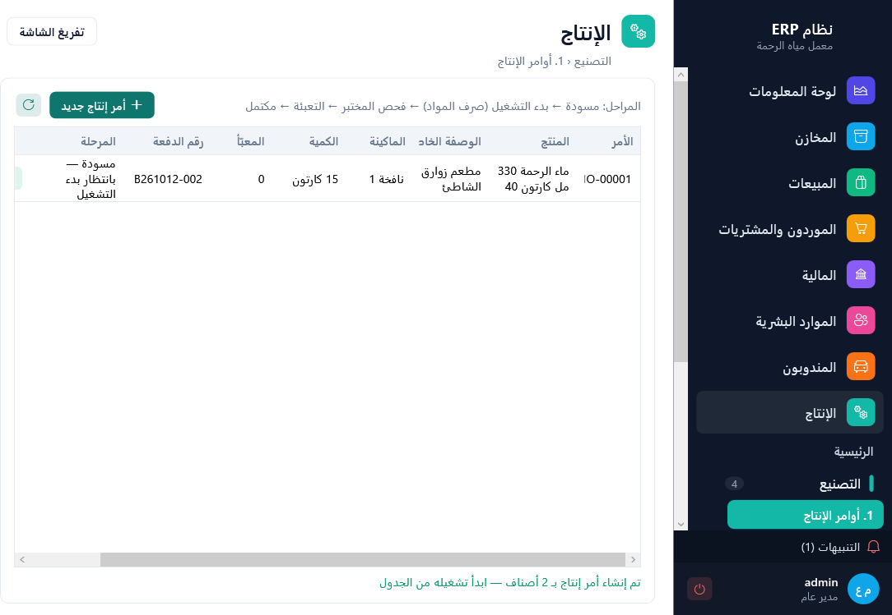
4. **بدء التشغيل:** تُصرف المواد من مخزن المواد الأولية إلى رصيد الماكينة تحت التصنيع، والأمر «بانتظار فحص المختبر».

   

## 4) تحت التصنيع (الإنتاج ← التصنيع ← تحت التصنيع)
رصيد **المواد الأولية** على الماكينة بالقطعة: المصروف، والمستهلك فعلًا (الإنتاج × الوصفة)، والتالف، والمرجّع، والمتبقي — لاكتشاف الهدر.

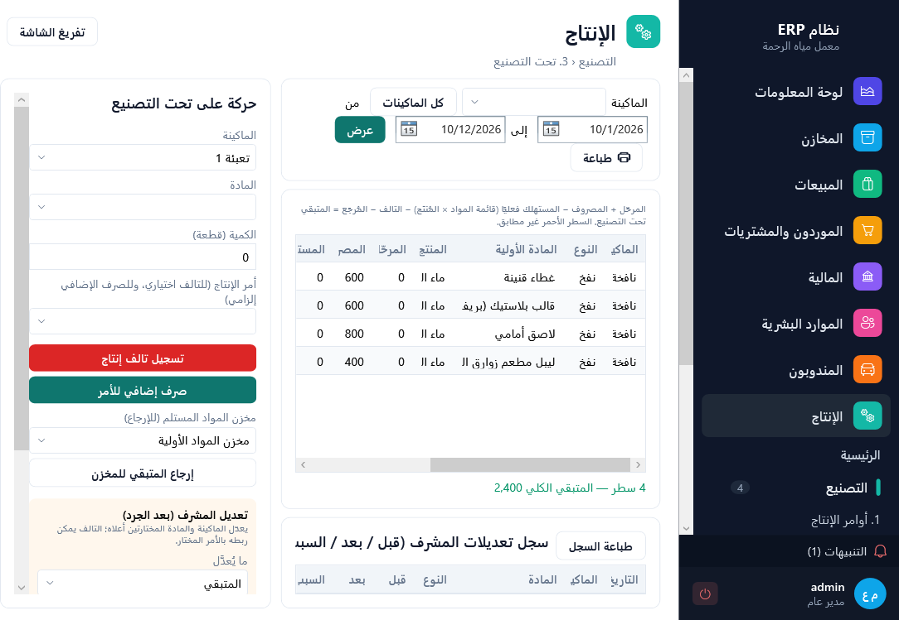

## 5) فحص المختبر — للأمر كله (وحدة المختبر)
الجرس ينبّه «بانتظار فحص المختبر» ويفتح شاشة الفحص على الأمر مباشرة. أدخل النتائج **مرة واحدة**؛ النتيجة تسري على السطرين (العام والمطعم)، وفشل اختبار واحد يرفض الأمر كله.

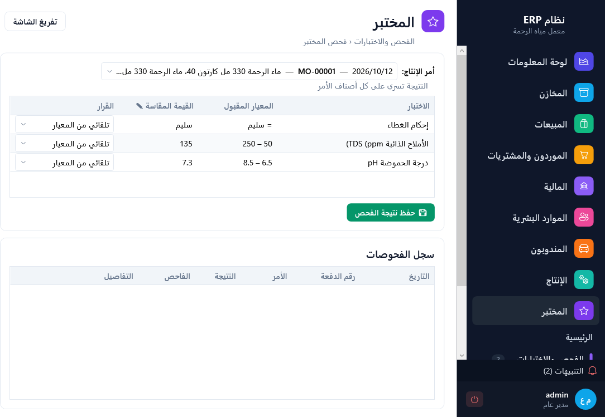
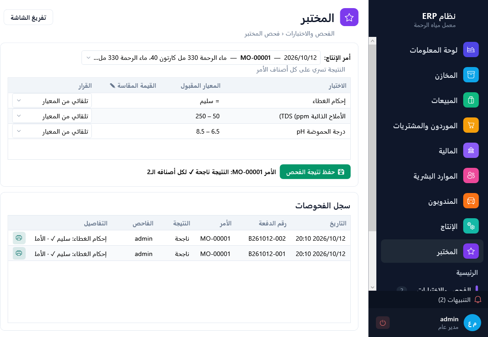

> المختبر وحدة مستقلة بصلاحيتها: من ينتج لا يحكم على جودة إنتاجه. التعبئة ممنوعة لأي أمر لم ينجح فحصه.

## 6) التعبئة إلى مخزن المنتج التام (الإنتاج ← التصنيع ← أوامر التعبئة)
لكل سطر على حدة: اختر السطر، فتظهر الوحدة «كارتون» والعدد كل المتبقي (10 للعام، 5 للمطعم)، ومخزن المنتج التام ← «تعبئة».
السطر يعرض «المطلوب — المعبّأ — المتبقي» بالكارتون.

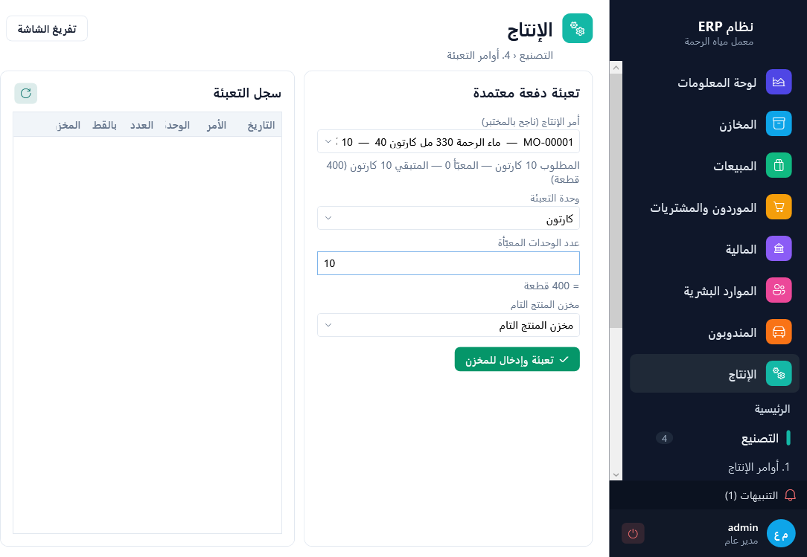
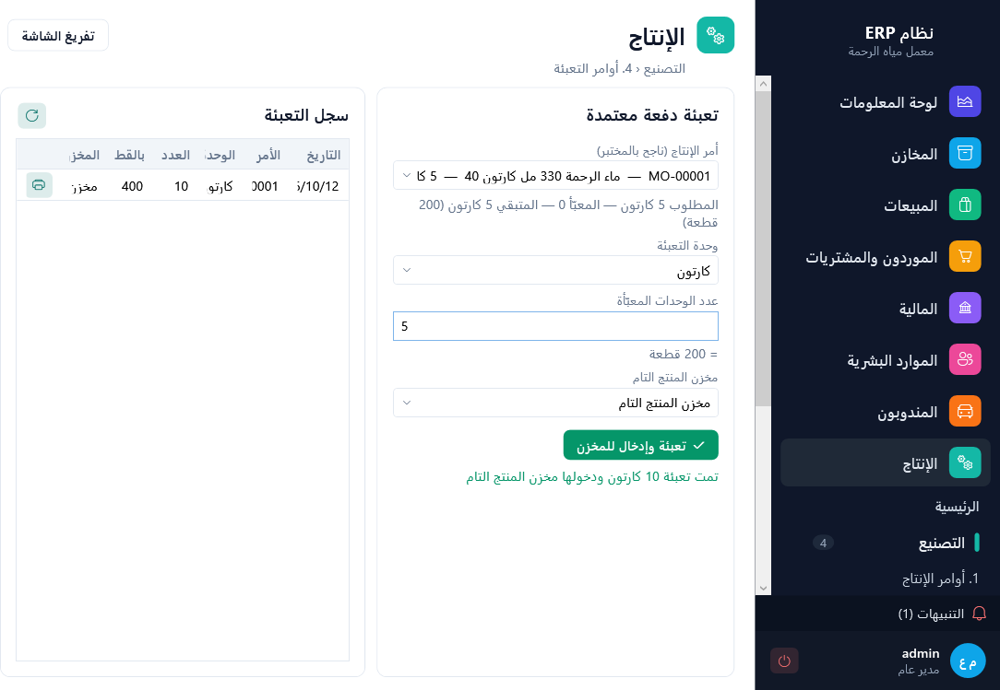

الرصيد في **مخزن المنتج التام ← الأرصدة الحالية**: 10 كارتون عام، و5 كارتون باسم «مطعم زوارق الشاطئ» في عمود المتغير.

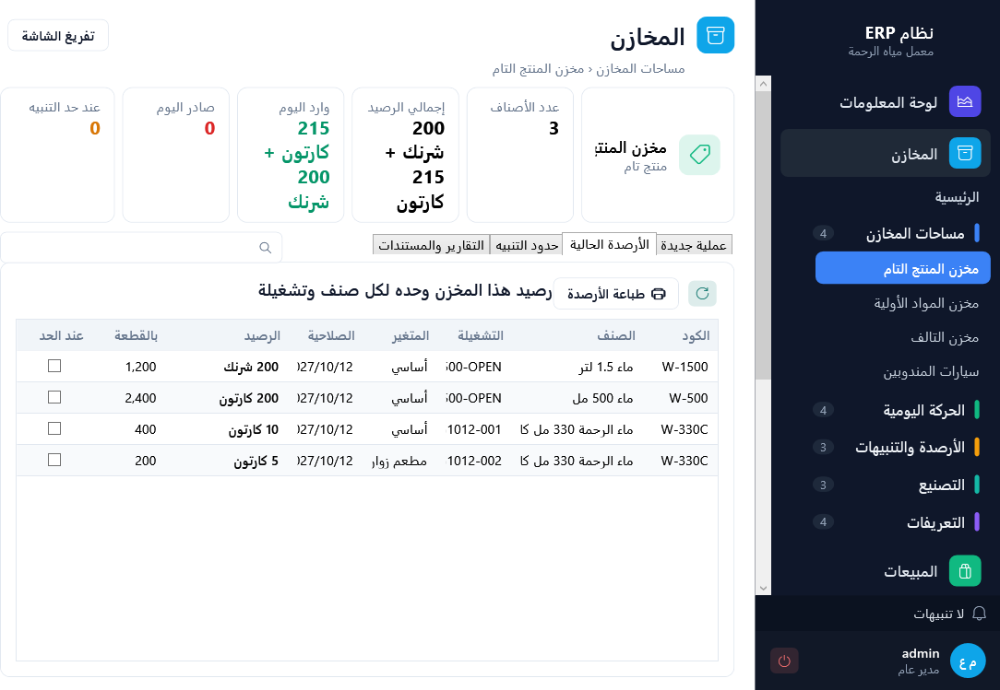

## 7) طلب تحميل لسيارة المندوب (المندوبون ← السيارات والتحميل ← طلبات التحميل)
السيارة «كاش فان علي»، من مخزن المنتج التام، سطران: المنتج **أساسي 6 كارتون**، والمنتج بمتغير **«مطعم زوارق الشاطئ» 5 كارتون** (لتوصيلها له). المتاح في المخزن يظهر بجانب كل سطر ← «إنشاء».

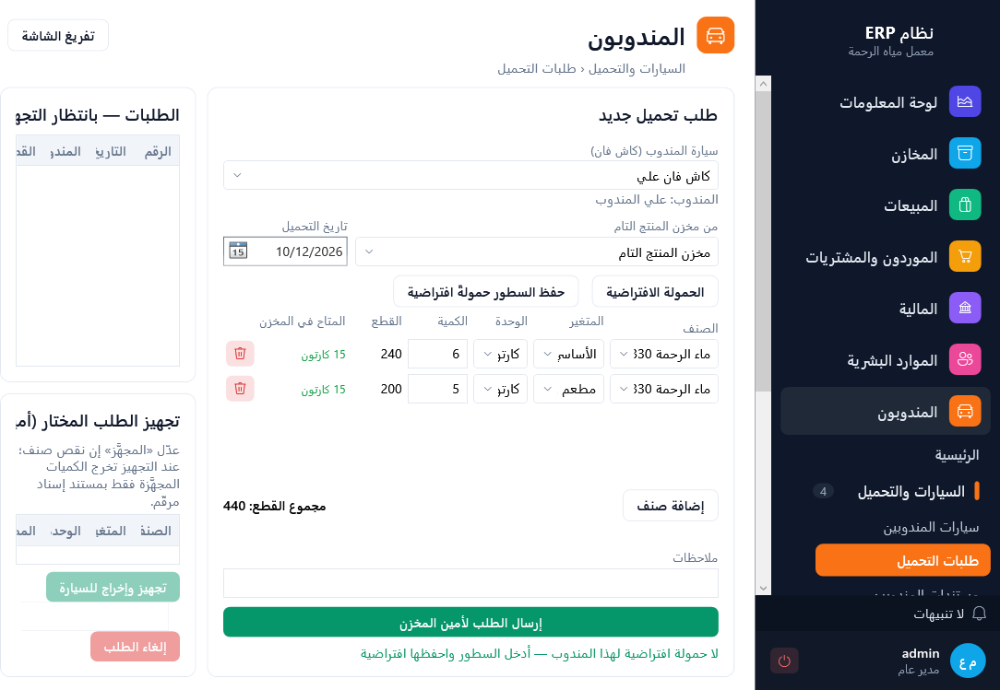

## 8) تجهيز الطلب في المخزن (المخازن ← الحركة اليومية ← طلبات التجهيز)
الجرس ينبّه أمين المخزن ويفتح الطلب. يراجع الكميات مقابل المتاح ← «تجهيز»، فتخرج البضاعة من مخزن المنتج التام إلى السيارة.

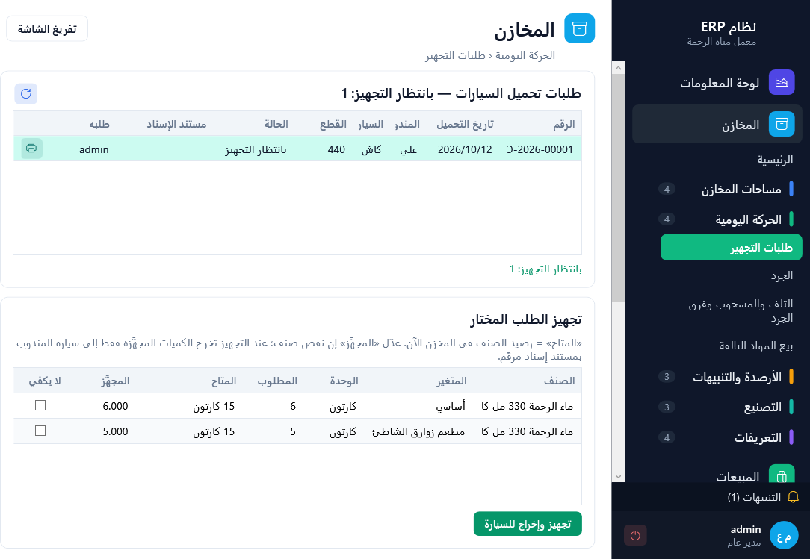
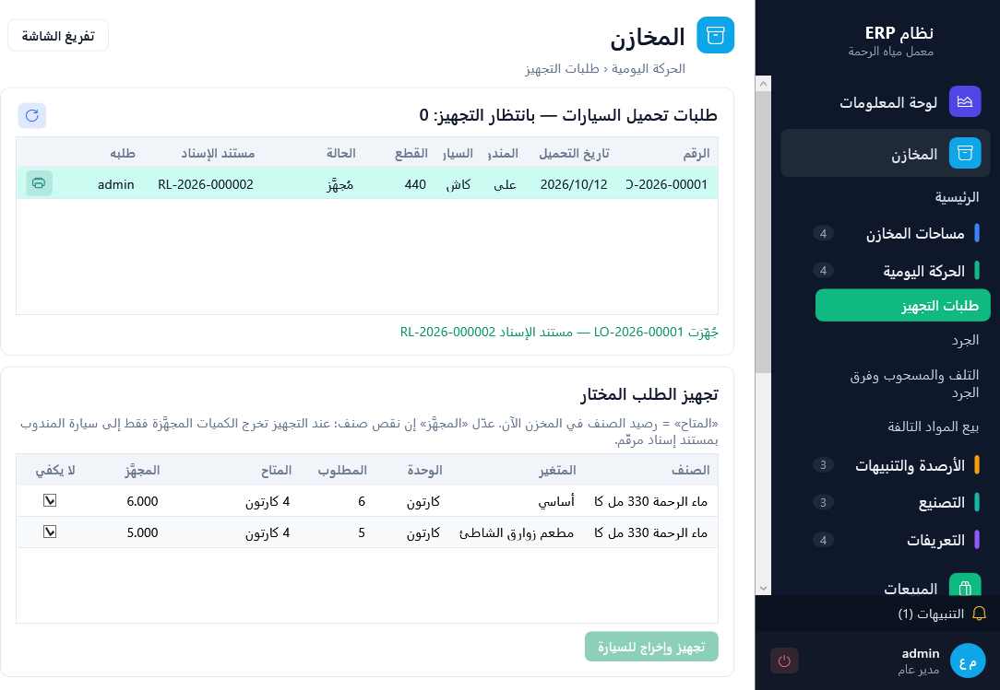

## 9) لوحة السيارات (المندوبون ← السيارات والتحميل ← سيارات المندوبين)
بطاقة «كاش فان علي»: حمولة اليوم، وعند الضغط تظهر شاشة السيارة بالرصيد: 6 كارتون أساسي و5 كارتون «مطعم زوارق الشاطئ».

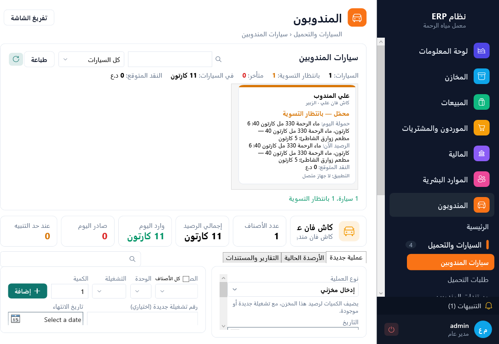

## أسئلة سريعة
- **لماذا المعاينة تطلب 400 ليبل خاص؟** 5 كراتين × 40 قنينة × ليبلان = 400.
- **هل يُصرف الليبل العام لكراتين المطعم؟** لا. وصفة المطعم تستبدله بالليبل الخاص.
- **هل يبيع المندوب كراتين المطعم لزبون آخر؟** لا، إلا بصلاحية «البيع من رصيد محجوز لعميل آخر». الكراتين العامة لأي زبون.
