# تفعيل تطبيق المندوبين — خطوة بخطوة (الحاسوب ثم الهاتف)

> يُفعَّل كل هاتف **مرة واحدة**: تُجهَّز المزامنة في المعمل، ثم يُسجَّل الهاتف باسم المندوب فيظهر **رمز QR**، ثم يصوّره المندوب من تطبيقه.
> الصور 1–5 **لقطات حقيقية** من البرنامج على Windows. الصور 6–8 **رسوم توضيحية** لشاشات الهاتف مطابقة لتصميم التطبيق (وليست لقطات من هاتف).
> قبل البدء: ثبّت ملف التطبيق على الهاتف (انظر [التنزيل والتثبيت](../rep-app.md#التنزيل-والتثبيت-على-الهاتف))، وثبّت النظام على حاسبة السيرفر بوضع «السيرفر» (يجهّز الخادم المحلي وخدمة المزامنة تلقائيًا؛ انظر [المزامنة بنظامين معًا](../sync.md)).
> الصور 1–3 من الإصدار السابق لشاشة المزامنة: الشاشة الحالية فيها خانة «الخادم المحلي» والمفتاح يُولَّد تلقائيًا.

## الصورة الكبيرة: كيف تتصل الحركة؟
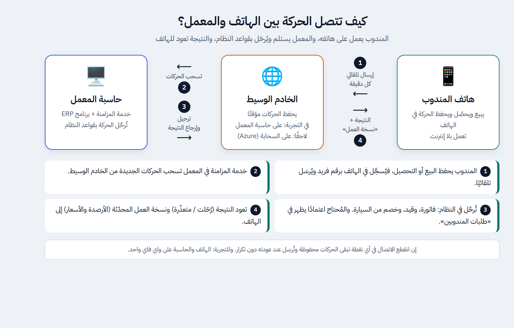

## أولًا: على حاسوب المعمل (المدير)

### 1) المزامنة: الخادم المحلي والتفعيل
«الإعدادات ← النظام ← المزامنة السحابية». ضع علامة **تفعيل المزامنة** و**الخادم المحلي على حاسبة السيرفر**. عنوان الخادم السحابي (`https://…`) اختياري ويُضاف متى شئت.

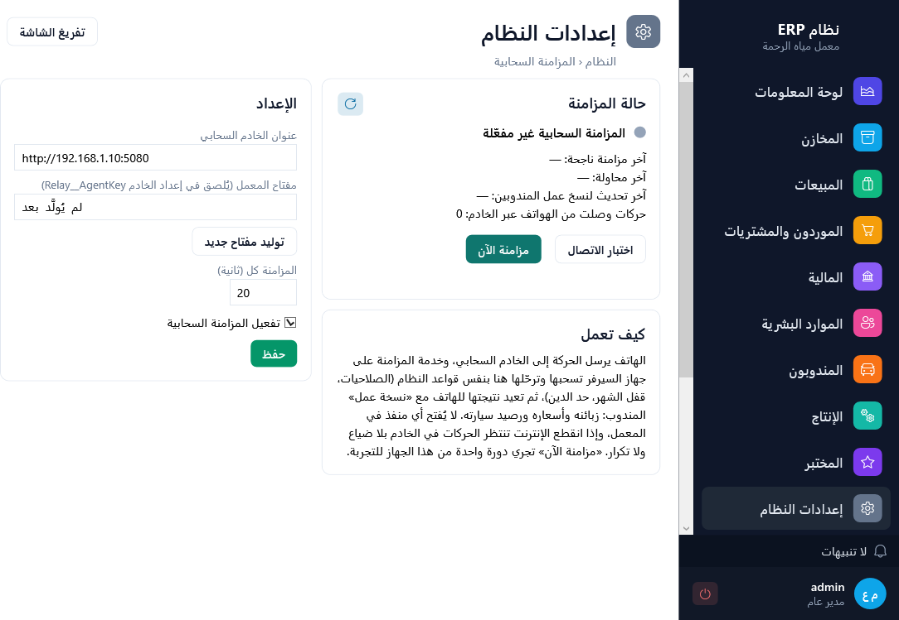

### 2) مفتاح المعمل (تلقائي)
لا شيء تفعله: يُولَّد المفتاح عند أول حفظ ويصل الخادم المحلي وحده، والسحابي يأخذه ضمن «ملفات نشر الخادم السحابي». زر **توليد مفتاح جديد** للتجديد فقط.

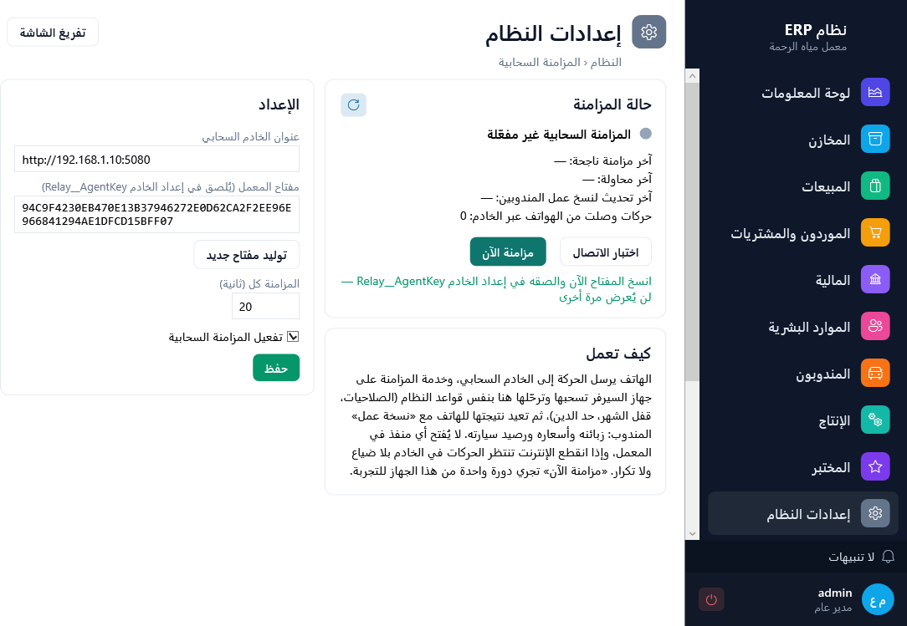

### 3) حفظ الإعداد
اضغط **حفظ**. تظهر حالة كل خادم بلونه، ويظهر **عنوان الخادم المحلي** الذي كتبته خدمة المزامنة من عنوان الحاسبة.

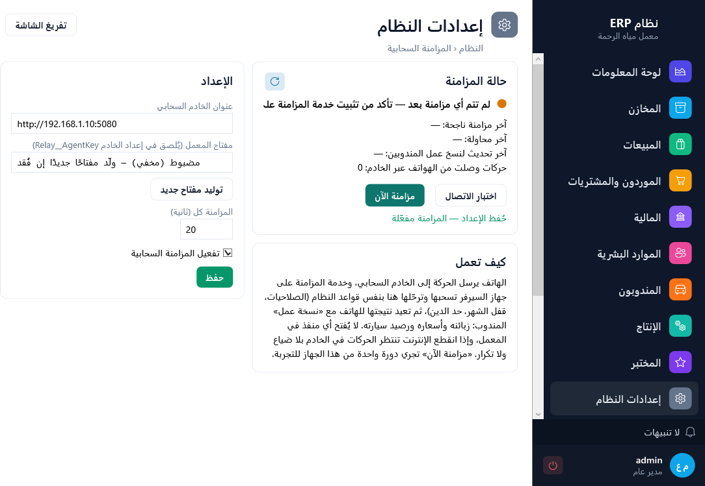

### 4) تسجيل هاتف المندوب
«المندوبون ← تطبيق المندوب ← أجهزة التطبيق». اختر **المندوب** واكتب **اسمًا للجهاز** (مثل «هاتف علي — سامسونج»).

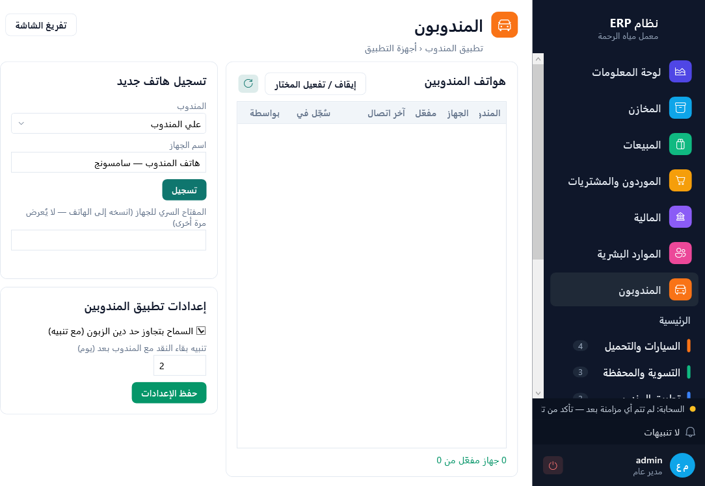

### 5) رمز الربط QR
اضغط **تسجيل**. يظهر **رمز QR مرة واحدة فقط** مع عنوان الخادم، ويظهر الهاتف في جدول «هواتف المندوبين». أبقِ الشاشة مفتوحة حتى يصوّره المندوب (والمفتاح السري المكتوب فوق الرمز جزء منه، ولا يُستعمل وحده). الرمز يحمل الخادمين معًا وبصمة المعمل. إن لم يظهر فانتظر حتى يظهر عنوان الخادم المحلي في الخطوة 3 (أو اكتب عنوان السحابي) ثم سجّل الجهاز.

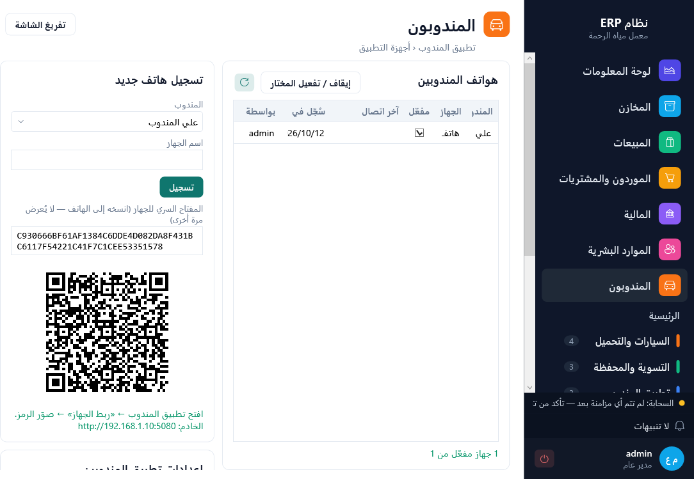

## ثانيًا: على هاتف المندوب

### 6) افتح التطبيق واضغط «تصوير رمز الربط»
تظهر شاشة «ربط الجهاز» عند أول فتح. اسمح للتطبيق باستخدام الكاميرا إن طُلب.

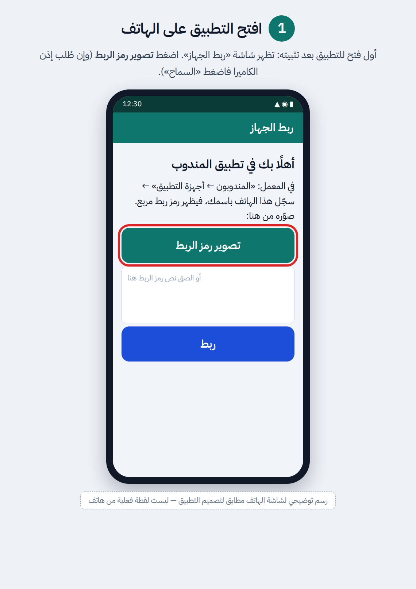

### 7) وجّه الكاميرا نحو الرمز
وجّهها نحو الرمز على شاشة الحاسوب؛ يُقرأ تلقائيًا ثم يُربط الهاتف. (التطبيق فيه خانة للصق نص الرمز، لكن البرنامج لا يعرض نص الرمز حاليًا، فالتصوير هو الطريقة المتاحة.)

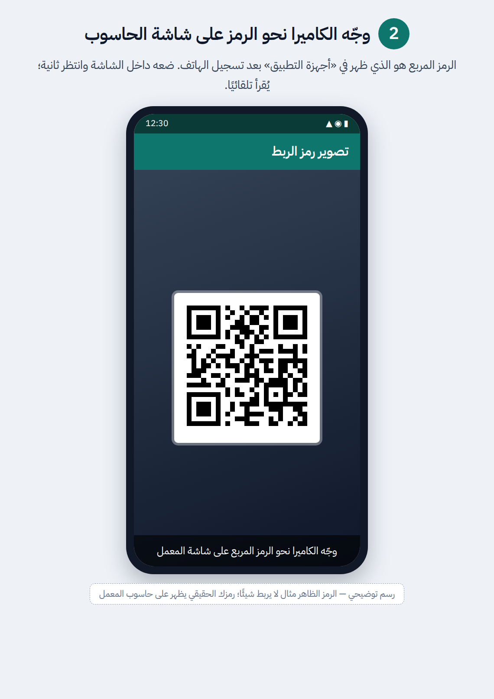

### 8) تم الربط
تظهر الرئيسية باسم المندوب وحالة الاتصال، وتصل «نسخة العمل» (الزبائن والأسعار ورصيد السيارة) خلال دقيقة. إن لم تصل فانتظر دقيقة ثم **مزامنة الآن**.

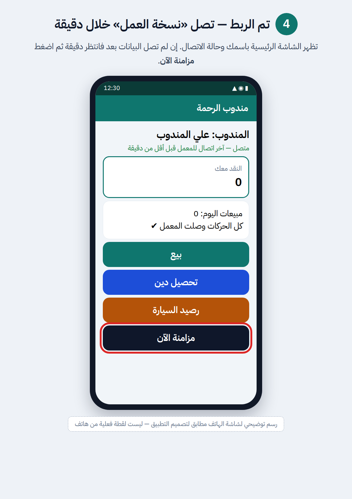

## ثالثًا: العمل اليومي على هاتف المندوب
> هذه الصور رسوم توضيحية لشاشات الهاتف (الأسماء والأرقام أمثلة).

### 9) البيع (نقدي / آجل / مجاني)
اختر النوع والزبون، ثم **المادة من القائمة**: تظهر فيها المواد المحمّلة في السيارة فقط وبعبوتها (مثل «ماء 330 مل — كارتون 40»). اكتب **العدد** ثم **إضافة للفاتورة**، وكرّر لكل مادة. السعر والإجمالي يظهران فورًا ولا خصم من الهاتف.

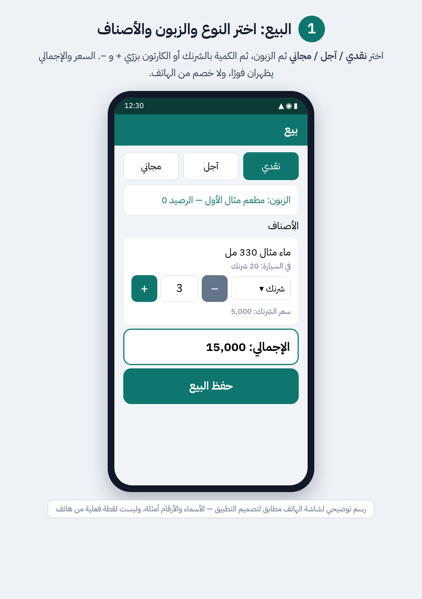

### 10) تأكيد البيع والحفظ
تظهر نافذة بالتفاصيل؛ اضغط **حفظ**. يُحفظ في الهاتف وتتحرك الأرصدة فورًا (حتى بلا إنترنت).

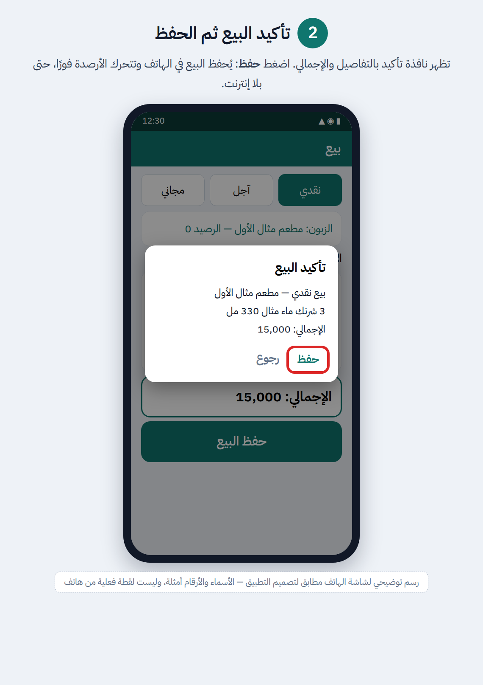

### طباعة وصل البيع
بعد حفظ البيع يظهر: **طباعة الوصل** أو **مشاركة صورة الوصل** أو «لاحقًا» (ويُطبع لاحقًا من «حركاتي» بزر «طباعة الوصل»).
الوصل: شعار المعمل واسمه، رقم الوصل (رقم المندوب ثم تسلسله، مثل 7-15)، التاريخ، الزبون، المواد بالعدد والسعر والمبلغ، الإجمالي، اسم المندوب، و«شكرا لتعاملكم معنا».
- **جهاز نقاط البيع بطابعة مدمجة:** شغّل البلوتوث؛ أول طباعة تعرض الأجهزة المقترنة فاختر الطابعة المدمجة (تظهر عادة باسم مثل InnerPrinter) ثم عرض الورق (58 ملم غالبًا).
- **هاتف عادي:** اقرن طابعة بلوتوث حرارية من إعدادات الهاتف ثم اخترها بالطريقة نفسها، أو استعمل **مشاركة صورة الوصل** (واتساب للزبون، أو تطبيق طباعة).
- لتغيير الطابعة: القائمة ⋮ ← **الطابعة**.
- إن لم تطبع الطابعة المدمجة في جهازك عبر البلوتوث فشارك الصورة، وأرسل لنا طراز الجهاز (الإعدادات ← حول الجهاز) لنضيف طريقة طابعته.

### زبون جديد من الهاتف
من الرئيسية **زبون جديد** (أو «+ زبون جديد» تحت اختيار الزبون في البيع): الاسم والنوع (مباشر / وكيل / عميل فرعي لوكيل) والهاتف والعنوان والمحافظة وحد الدين، بحقول شاشة «العملاء» نفسها. يظهر فورًا بعلامة «(جديد)» ويُباع له حتى بلا إنترنت، ثم يُسجَّل في المعمل مُسندًا للمندوب ويظهر في «المبيعات ← العملاء»، ويصل «طلبات المندوبين» للاطلاع.

### 11) تحصيل دين
الزبون ثم **المبلغ المستلم** ثم **حفظ التحصيل**.

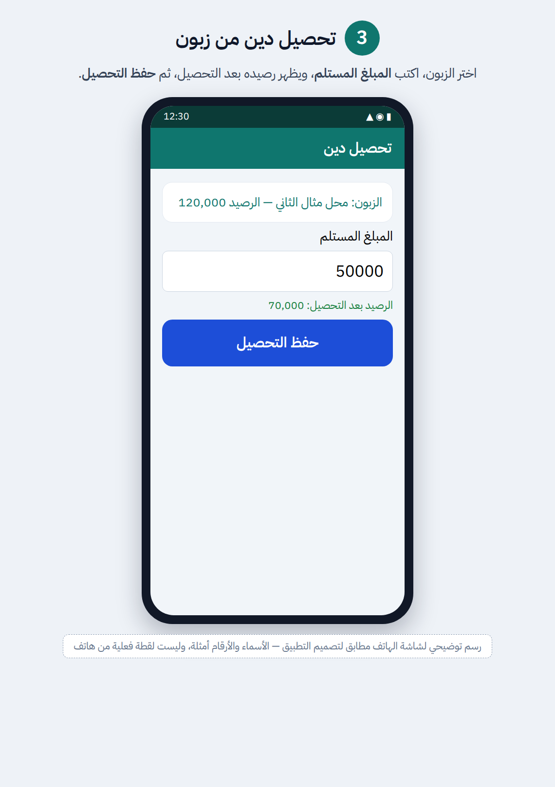

### 12) رصيد السيارة والنقد
ما في السيارة بالعبوات والنقد معك وتاريخ آخر نسخة عمل.

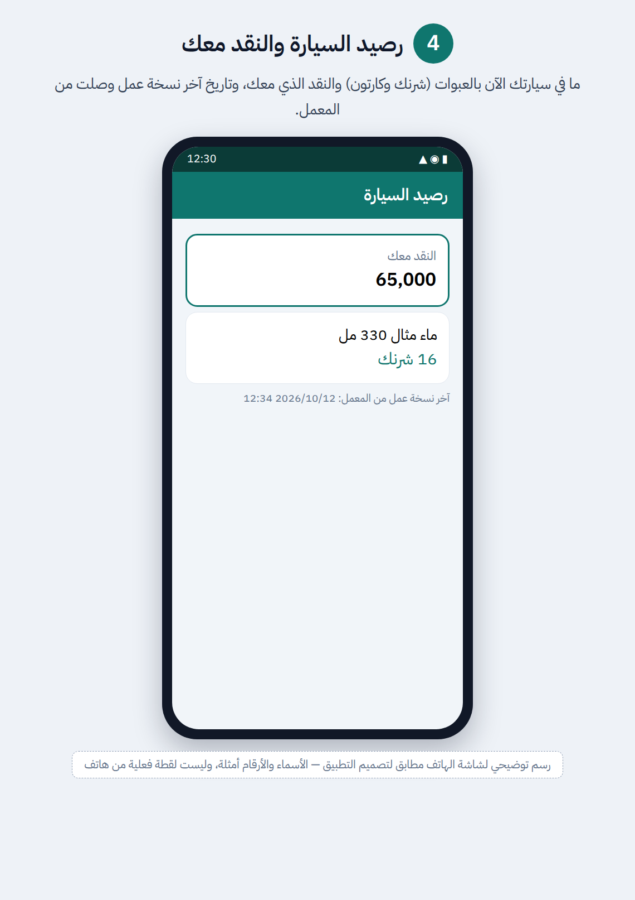

### 13) حركاتي
في الأعلى **مواد بيع اليوم** بأعدادها، ثم كل حركة برقم وصلها وموادها وأعدادها. حالة كل حركة: بانتظار الإرسال ← وصلت الخادم ← رُحّلت. المتعذّرة بالأحمر مع السبب وزر **إعادة الإرسال**.

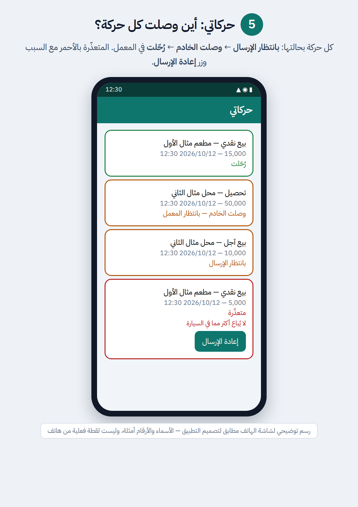

### 14) بلا إنترنت
تظهر «لا اتصال» بالأصفر، وتبقى الحركات في الهاتف وتُرسَل تلقائيًا عند عودة الشبكة دون تكرار.

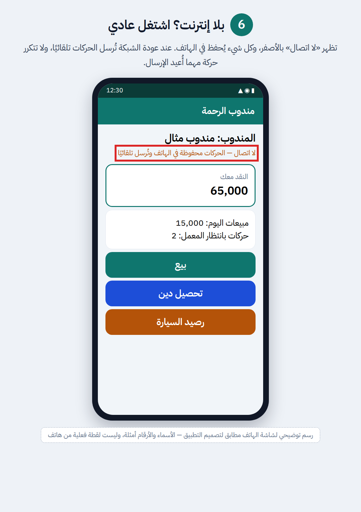

## رابعًا: ما يصل إلى المعمل (لقطات حقيقية من البرنامج)
### 15) طلبات المندوبين
«المندوبون ← طلبات المندوبين»: كل ما أرسلته الهواتف بحالته (رُحّلت، أو بانتظار الاعتماد).

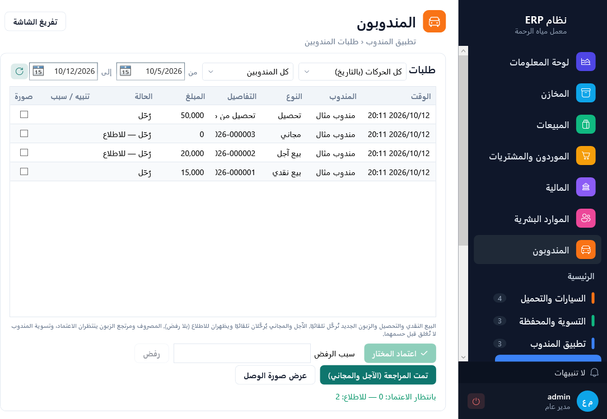

### 16) للاطلاع: الآجل والمجاني
فلتر «للاطلاع» يعرض البيع الآجل والمجاني ليراجعها المدير.

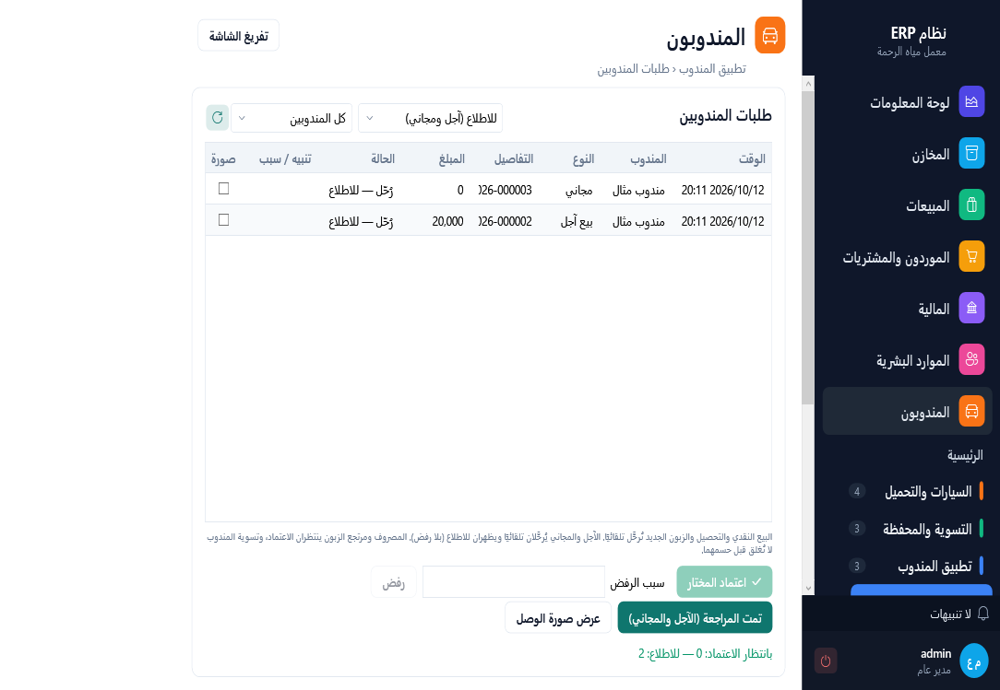

### 17) سيارات المندوبين
رصيد كل سيارة بالعبوات والنقد المتوقع بعد البيع.

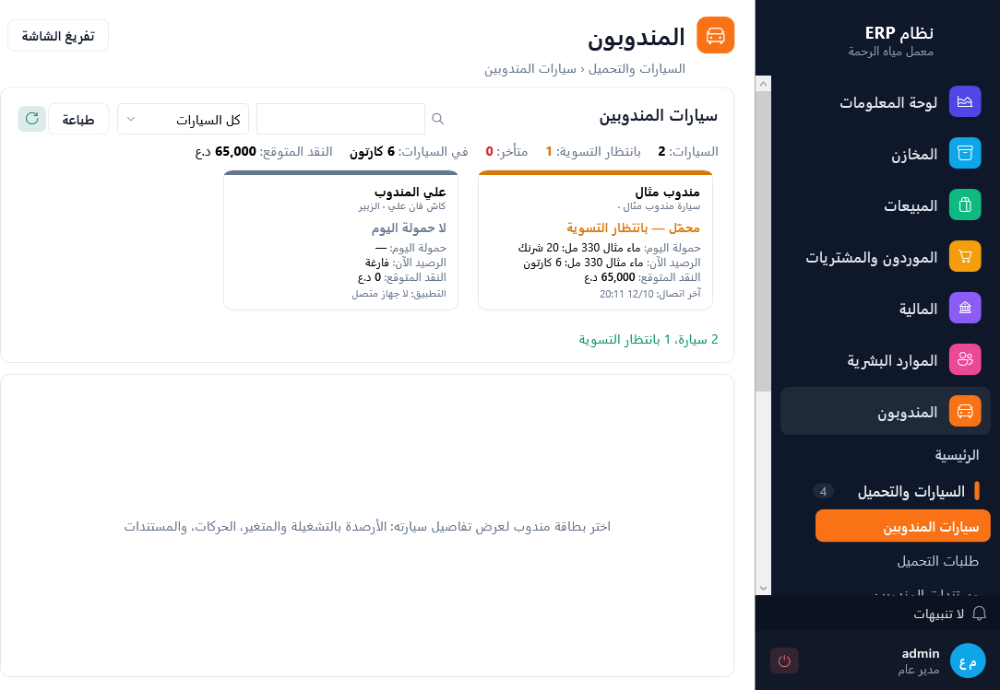

## إذا لم يعمل
| الظاهر | السبب والحل |
|---|---|
| لا يظهر رمز QR بعد «تسجيل» | عنوان الخادم غير مضبوط: «الإعدادات ← المزامنة السحابية» |
| الهاتف لا يقرأ الرمز | قرّب الهاتف وخفّف لمعان الشاشة، وكبّر نافذة البرنامج، ثم أعد التصوير |
| «رُبط الجهاز» ثم رسالة خطأ | الهاتف غير متصل بنفس شبكة المعمل (في التجربة) أو بالإنترنت، أو لم تصل بياناته للخادم بعد؛ انتظر دقيقة ثم «مزامنة الآن» |
| ضاع الرمز أو أُغلقت الشاشة قبل تصويره | الرمز يظهر مرة واحدة: سجّل الجهاز من جديد |

**تغيّر عنوان الخادم (شبكة جديدة أو خادم جديد):** في الهاتف القائمة ⋮ ← **تغيير عنوان الخادم**، واكتب العنوان الجديد (مثل `http://192.168.0.191:5080`) ثم **اختبار وحفظ**. يبقى الربط وكل الحركات، وما لم يُرسل يذهب للعنوان الجديد.
**إيقاف هاتف ضائع:** «أجهزة التطبيق»، اختر الجهاز ثم **إيقاف**، فيُرفض في الدورة التالية.
**حذف جهاز:** «أجهزة التطبيق»، اختر الجهاز ثم **حذف الجهاز**. بلا حركات يُحذف نهائيًا، وإن كانت له حركات يُخفى ويُوقف وتبقى حركاته في «طلبات المندوبين». لإعادته يُسجَّل من جديد.
**الشعار واسم المعمل في التطبيق:** من «الإعدادات ← هوية الطباعة» (الشعار حتى 200 كيلوبايت يصل الهاتف).
**نقل الهاتف لمندوب آخر:** من قائمة التطبيق «فك الربط» (يُمنع ما دامت حركات لم تصل المعمل).
