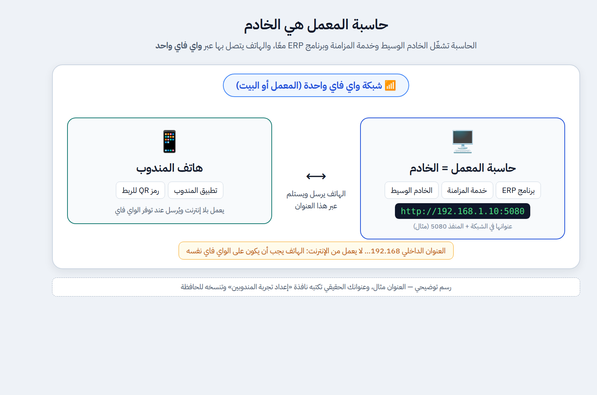
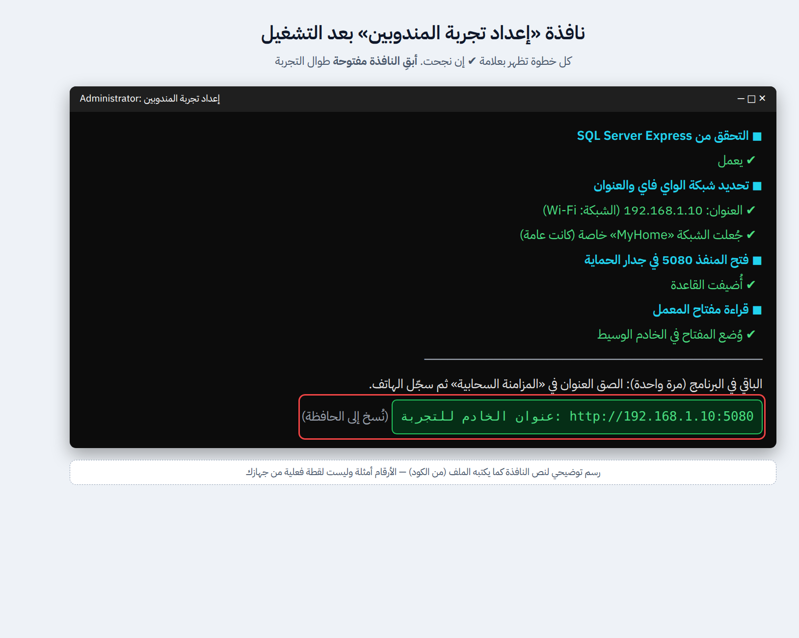
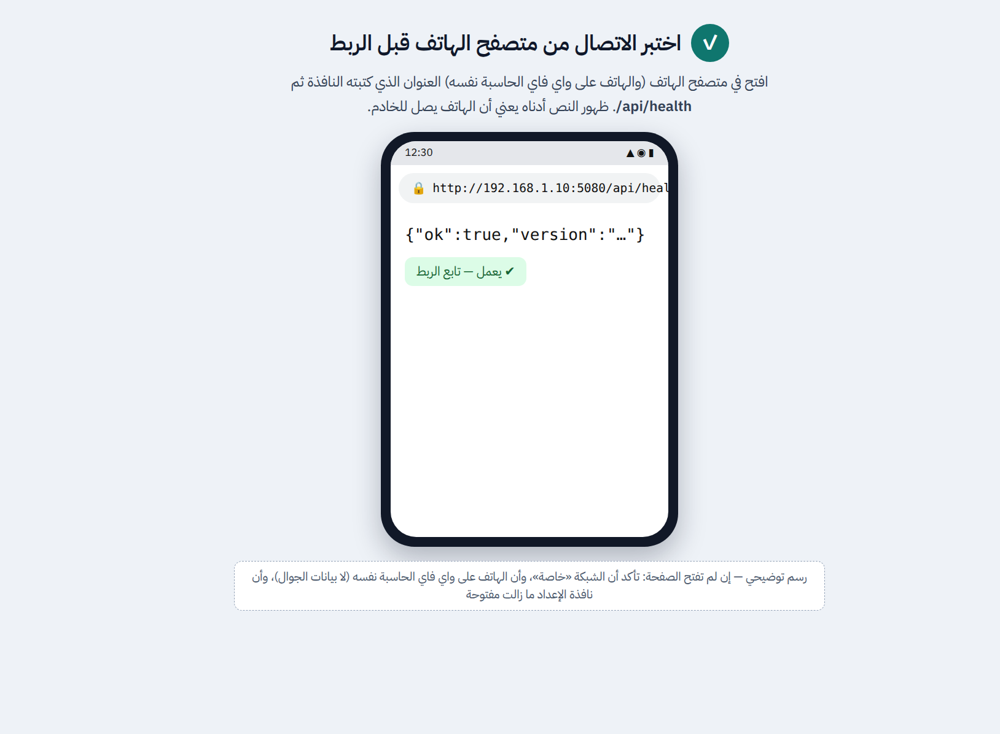

# الربط السحابي والحاسبة هي الخادم — خطوة بخطوة

> الحاسبة تشغّل الخادم الوسيط وخدمة المزامنة وبرنامج ERP معًا، والهاتف يتصل بها عبر **واي فاي واحد** (المعمل أو البيت).
> لقطات برنامج الحاسبة (الخطوات 1 و3 و5 و6) **حقيقية من Windows**. أما المخطط ونافذة الإعداد واختبار المتصفح وشاشات الهاتف فهي **رسوم توضيحية** (العنوان والأرقام أمثلة، ونص النافذة مأخوذ من الكود لا من جهاز حقيقي).

## قبل البدء
- الهاتف والحاسبة على **واي فاي واحد** (لا بيانات الجوال).
- التطبيق مثبّت على الهاتف ([التنزيل والتثبيت](../rep-app.md#التنزيل-والتثبيت-على-الهاتف)).
- برنامج ERP مفتوح على الحاسبة.

## الخطوات

### 1) ولّد مفتاح المعمل
«الإعدادات ← المزامنة السحابية ← **توليد مفتاح جديد**». لا حاجة لنسخه: ملف الإعداد يقرؤه بنفسه.

### 2) شغّل «إعداد تجربة المندوبين.cmd»
من مجلد «تجربة المندوبين»، ووافق على نافذة ويندوز. يفتح المنفذ 5080، ويجعل شبكة الواي فاي «خاصة» إن كانت «عامة»، ويتحقق من SQL Server Express، ويضع المفتاح في الخادم، ثم يكتب **عنوان الخادم** وينسخه للحافظة. **أبقِ النافذة مفتوحة** طوال التجربة.

### 3) الصق العنوان في المزامنة السحابية
«الإعدادات ← المزامنة السحابية»: الصق العنوان في «عنوان الخادم السحابي»، وضع علامة **تفعيل المزامنة السحابية**، ثم **حفظ**، ثم **اختبار الاتصال**.

### 4) اختبر الهاتف قبل الربط
من متصفح الهاتف افتح عنوان الخادم متبوعًا بـ `/api/health`. إن ظهر `{"ok":true…}` فالهاتف يصل للخادم.

### 5) سجّل الهاتف في المعمل
«المندوبون ← تطبيق المندوب ← أجهزة التطبيق»: اختر المندوب واكتب اسم الجهاز.

### 6) رمز الربط QR
اضغط **تسجيل**؛ يظهر الرمز مرة واحدة فقط. أبقِ الشاشة مفتوحة.

### 7) صوّر الرمز من الهاتف
افتح التطبيق ← **تصوير رمز الربط** ← وجّه الكاميرا نحو الرمز.

### 8) تم الربط
تظهر الرئيسية باسم المندوب، وتصل «نسخة العمل» خلال دقيقة، وإلا فاضغط **مزامنة الآن**. في البرنامج تظهر «آخر مزامنة ناجحة» في «المزامنة السحابية».

## إذا تعثّرت
| المشكلة | الحل |
|---|---|
| رابط الاختبار (4) لا يفتح | الشبكة ليست «خاصة»، أو الهاتف على بيانات الجوال لا على واي فاي الحاسبة، أو نافذة الإعداد أُغلقت |
| النافذة تقول «لا مفتاح للمعمل» | ولّد مفتاحًا (الخطوة 1) ثم أعد تشغيل الملف |
| النافذة تقول إن SQL Server Express غير موجود | الخادم الوسيط يحتاجه؛ ثبّته |
| تغيّر عنوان الحاسبة بعد إعادة تشغيلها | شغّل الملف ثانية، والصق العنوان الجديد، وسجّل الهاتف من جديد (الرمز يحمل العنوان القديم) |
| لا يظهر رمز QR | عنوان الخادم لم يُحفظ في الخطوة 3 |

**الإيقاف بعد التجربة:** أغلق النافذة، ثم احذف قاعدة جدار الحماية:
`netsh advfirewall firewall delete rule name="ERP Rep Trial"`
